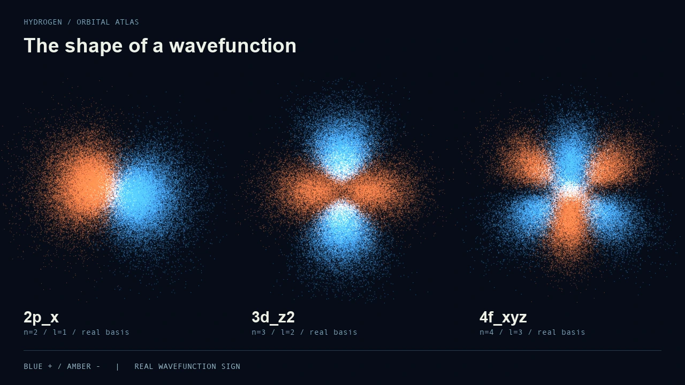

# Hydrogen Orbital Explorer

An interactive atlas of 30 hydrogen orbitals, written in C++17 and OpenGL.
Explore the shape of a wavefunction by rotating a cloud sampled from its
probability density. Switch between familiar real orbitals and complex states
with a visible probability current.



The preview is rendered from points generated by the C++ sampler. The camera
moves around stationary real orbitals; it does not show electrons travelling
along trajectories. [Watch the rotation](media/orbitals-rotation.mp4).

## Explore

- All 30 real basis functions for shells **n = 1–4**: s, p, d and f.
- Real mode: blue and orange encode the sign of the full spatial wavefunction,
  including changes across radial nodes.
- Complex mode: the matching density for a definite magnetic quantum number
  and tracers following its azimuthal probability-current velocity field.
- An orbital camera, deterministic resampling and background cloud generation.
- A small numerical core that builds and tests independently of OpenGL.

This is an educational visualisation of the analytic, nonrelativistic hydrogen
solutions in atomic units. The nucleus is fixed; spin, external fields,
many-electron interactions and time-dependent superpositions are outside its
scope. Display time and brightness are chosen for readability.

## Build on macOS

Requires a C++17 compiler, CMake 3.15 or newer, GLFW and GLM. Install the Xcode
Command Line Tools if a compiler is not already available, then:

```sh
brew install cmake glfw glm
cmake -S . -B build -DCMAKE_BUILD_TYPE=Release
cmake --build build --parallel
(cd build && ctest --output-on-failure)
./build/quantum_orbitals
```

`./build.sh` is a convenience wrapper for the same build. The graphical app
currently targets macOS. The mathematics and tests have no graphics dependencies:

```sh
cmake -S . -B build-core -DBUILD_VISUALIZER=OFF -DCMAKE_BUILD_TYPE=Release
cmake --build build-core --parallel
(cd build-core && ctest --output-on-failure)
```

## Controls

| Input | Action |
| --- | --- |
| Left / Right, Tab / Shift+Tab | Previous / next orbital |
| 1–4 | Jump to a shell |
| F | Switch real orbitals / complex states with current |
| + / − | Change current animation speed |
| R | Resample with a new seed |
| A | Toggle coordinate axes |
| Left drag | Rotate the camera |
| Scroll | Zoom |
| Escape | Close |

In real mode the signed basis index selects a cosine or sine harmonic. For
example, p_x and p_y are combinations of the complex m = +1 and m = −1 states;
the index is not a claim that these orbitals have a definite Lz. In complex
mode m is the magnetic quantum number. States with m = 0 have no orbital
probability current.

## Mathematics

The radial factor uses associated Laguerre polynomials, and the angular factor
uses associated Legendre polynomials and real or complex spherical harmonics:

```text
ψ(r, θ, φ) = R_nl(r) Y_lm(θ, φ)
ρ(x, y, z) = |ψ(x, y, z)|²
```

The real harmonics use a convention without the Condon–Shortley phase. Global
sign choices do not change the density. The sampler separates radial and angular
coordinates; its radial distribution includes the spherical Jacobian r².
The radial CDF is integrated analytically and inverted numerically. Angular
rejection uses a bound from the spherical-harmonic addition theorem, avoiding a
coarse-grid estimate of the maximum. Each shell is clipped at a radius retaining
at least 99.9% of every included orbital's radial probability, to tested
floating-point accuracy; the displayed distribution is conditional on that cut.

For a complex state with definite m, the probability current is azimuthal:

```text
vφ = m / ρ_cyl
ω = m / ρ_cyl²
```

The tracers are seeded from that same complex-state density. Their angular
update preserves cylindrical radius and uses elapsed time. Visual speed is
rescaled between shells; this is a picture of the current field, not a measured
electron path. Rapid near-axis motion can alias at a display's frame rate.

## Source map

| File | Responsibility |
| --- | --- |
| `src/quantum.cpp` | Analytic radial and angular functions |
| `src/sampling.cpp` | Probability-density sampling |
| `src/flow.cpp` | Complex-state current tracers |
| `src/renderer.cpp` | OpenGL buffers and shaders |
| `src/main.cpp` | Input, background generation and app lifecycle |
| `tests/quantum_tests.cpp` | Numerical and sampling regression checks |
| `tools/` | Reproduce the point-cloud previews |

This project sits alongside my [N-body simulator](https://github.com/MatuZale/Projekt-n-bodies):
two explorations of physics, numerical methods and 3D graphics in C++.

## Reproduce the previews

`export_cloud` is built by default and exports real-orbital samples as CSV.
The optional preview renderer needs Python, NumPy and Pillow; MP4 output also
uses imageio-ffmpeg. Install these in a virtual environment if needed:

```sh
python3 -m venv .venv
. .venv/bin/activate
python -m pip install numpy pillow imageio-ffmpeg
python tools/render_preview.py --exporter build/export_cloud --movie
```

This produces the still and a 12-second camera-orbit MP4 in `media/`. The cached
CSV clouds stay local. The movie rotates the viewing direction, while the points
stay fixed. Its three panels use their own scale to make the shapes readable;
they are not a comparison of absolute orbital sizes. Blue and amber show the
sign of the full real wavefunction. The portfolio's VHS sleeve is a separate
editorial illustration inspired by the orbitals.

## References and dependencies

- [TU Delft: hydrogen wavefunctions and quantum-mechanical equations](https://interactivetextbooks.tudelft.nl/introduction-to-quantum-mechanics/content/equationsandconstants.html)
- [NIST DLMF §14.30: spherical harmonics](https://dlmf.nist.gov/14.30)
- [David Tong: Schrödinger equation and probability current](https://www.damtp.cam.ac.uk/user/tong/qm/qmhtml/S1.html)
- [GLFW](https://www.glfw.org/) — zlib/libpng licence; [GLM](https://github.com/g-truc/glm) — MIT licence.
- The current shader uses a five-stop approximation of the [Plasma colormap](https://github.com/BIDS/colormap), released under CC0.

MIT — see [LICENSE](LICENSE).
